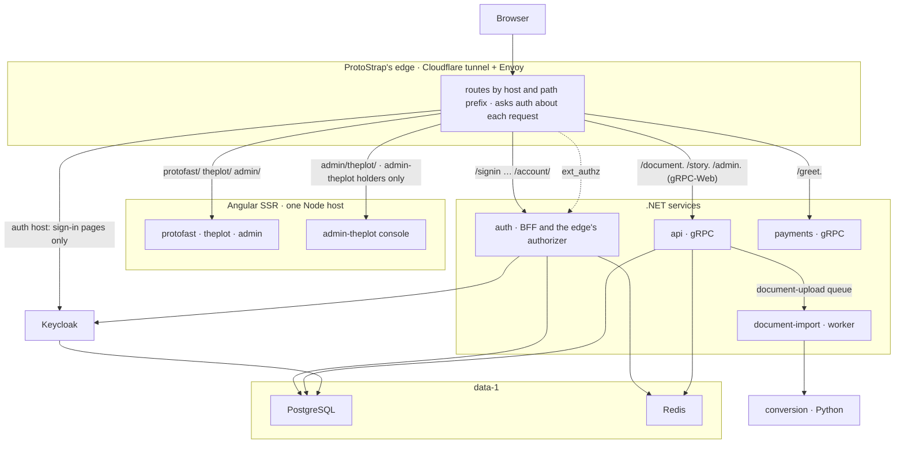

# ProtoFast

ProtoFast is a small platform: Angular SSR clients (the protofast product site, ThePlot, and an
admin host with a console per app), .NET services (auth, the api, payments, document-import),
a Python conversion service, Keycloak, PostgreSQL and Redis. It deploys with
[ProtoStrap](https://github.com/duncan-G/protostrap) 0.1.4 to one AWS account, prod. Dev is
the local run, `aspire run`.



The AppHost (`apphost/Program.cs`) is the whole application, written once: `aspire run` runs
it on a laptop behind the same edge an account runs, and it writes the spec ProtoStrap
deploys. [docs/README.md](docs/README.md) explains every layer;
[docs/protostrap-migration.md](docs/protostrap-migration.md) what moved to ProtoStrap.

| Path                         | What it is                                                              |
| ---------------------------- | ----------------------------------------------------------------------- |
| `apphost/`                   | The application, for `aspire run` and the spec                          |
| `protostrap.yaml`            | Prod's spec, written by the AppHost: never edit it                      |
| `services/`                  | auth, api, payments, document-import, conversion, the tasks (migrations, postgres-config), Keycloak's image and its realms' configure task, the browsers' collector, and shared code |
| `clients/`                   | The Angular clients and the Node host that serves them (`clients/Dockerfile`) |
| `infra/`                     | Terraform roots: `bootstrap` and `people` (an Org Admin, once), `prod` (the infra workflow) |
| `.github/workflows/`         | `ci` before merge; `deploy` (prod, after approval); `infra`             |
| `scripts/set-secrets.sh`     | Fills in prod's secret, for an Org Admin                                |

ProtoFast uses ProtoStrap's Claude Code skills, pinned in `.claude/settings.json` to the
version it deploys with.


## Running it

You need the .NET SDK `global.json` pins, Docker, Node 24, the Aspire CLI 13.6.2, and Go at
the version ProtoStrap's `go.mod` names, with a ProtoStrap checkout beside this repository
(`../ProtoStrap`): the AppHost builds ProtoStrap.Hosting and the `protostrap` CLI, which
renders the local edge, from it. On Ubuntu, `bash scripts/setup-dev-dependencies.sh`
installs Docker, Node's current LTS and the latest Aspire CLI when they're missing; the .NET
SDK and Go are yours to install. The services read dev's secret with an AWS SSO profile, below.

```bash
aspire run
```

| Open                                   | For                                                    |
| -------------------------------------- | ------------------------------------------------------ |
| http://protofast.dev.localhost:20000   | The product site                                       |
| http://theplot.dev.localhost:20000     | ThePlot                                                |
| http://admin.dev.localhost:20000       | The admin console, and ThePlot's at /theplot/          |
| http://auth.dev.localhost:20000        | Keycloak's sign-in pages (the edge routes only these)  |
| http://localhost:8025                  | smtp4dev, where every mail goes, sign-in codes included |
| The dashboard's link                   | Logs, traces and metrics, browsers' included           |

The clients run as Angular dev servers behind the edge; `SsrHost__Dev=true aspire run` (the
`https-ssr-host` profile) runs the production clients image instead. Admin operators
`protofast@admin.test` and `theplot@admin.test` sign in with the code smtp4dev receives.
The services read dev's secret, `protofast/dev`, as they read prod's, with the `developer` AWS
SSO profile, and the AppHost runs `aws sso login --profile developer` when there's no session
([layer 02](docs/02-local-development.md#local-secrets-and-keys)). Imports need a model API's
key in it, such as `../ProtoStrap/scripts/set-secret.sh protofast/dev
DocumentImport_Providers__deepseek__ApiKey=-`; without one, everything runs and imports fail at
the model call.

To run beside another AppHost that holds port 20000 or 8025:
`aspire run -- --LocalEdge:Port 20100 --Smtp4dev:Port 8125`.


## The spec

The AppHost writes it. After changing the AppHost, a project reference or a
`Directory.Build.targets`:

```bash
aspire do protostrap-spec
```

and commit `protostrap.yaml` with the change. CI fails when it isn't what the AppHost writes.


## Tests

```bash
dotnet test ProtoFast.slnx
```

Each client (`npm test` in `clients/<name>`), the clients host (`node --test` in
`clients/host`), conversion (`python -m pytest` in `services/conversion`) and Keycloak's
images (`test/entrypoint_test.sh`) have their own. `ci.yml` runs them all on every pull
request. GitHub has no check named `ci`: main's ruleset requires each of its jobs' checks.


## Deploying

ProtoFast deploys to prod with ProtoStrap's reusable workflows. An Org Admin does these once,
in order:

1. Copy `infra/bootstrap/terraform.tfvars.example` to `terraform.tfvars` and fill it in.
   Then, with the account's admin credentials and `GITHUB_TOKEN=$(gh auth token)`:
   `terraform -chdir=infra/bootstrap init && terraform -chdir=infra/bootstrap apply`.
2. Identity Center, in ProtoFast's one account, which is its organization's management
   account: enable it in the console, then apply `infra/people` (see its `main.tf`) with the
   account's id as `prod`. Its state goes in bootstrap's state bucket.
3. `gh secret set CLOUDFLARE_API_TOKEN --env prod-infra`.
4. The GitHub settings bootstrap doesn't make, before the workflows reach `main`: a
   `prod-approval` environment with required reviewers; required reviewers on `prod-infra`;
   `prod` and `prod-infra` limited to `main`; and a ruleset on `main` requiring review and
   every `ci.yml` job's check. Without them, the merge's deploy would run unapproved. Applying
   bootstrap again can clear the environments' reviewers and branch limits: check them after.
5. Merge to `main`. The merge starts `deploy.yml` and, since it adds `infra/prod`, an infra
   apply; both wait for approval. Reject them: nothing is set up yet.
6. `gh workflow run infra.yml -f action=plan`, read the plan, then `-f action=apply`. Confirm
   each alert email's SNS subscription.
7. The tunnel's token, with ProtoStrap's `scripts/set-edge-token.sh protofast prod`
   (`CLOUDFLARE_ACCOUNT_ID`, and a `CLOUDFLARE_API_TOKEN` that may edit tunnels), then every
   other key: `scripts/set-secrets.sh prod`, which makes every password and key itself and
   never shows one. Set the model APIs' keys prod uses as its comment says.
8. `gh workflow run deploy.yml`, and approve it. From then on every push to `main` deploys to
   prod once approved.

The account also holds dev's secret, `protofast/dev`, beside prod's, which `aspire run` reads.
A Developer makes it once and fills it with `scripts/set-secrets.sh dev`, with their Identity
Center sign-in ([layer 06](docs/06-secrets.md#dev)). Nothing is deployed for dev, and no
workflow touches its secret: dev is the local run.
