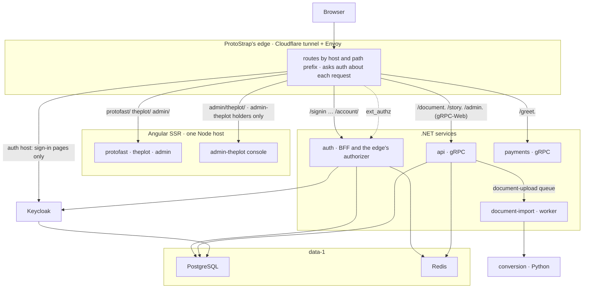

# ProtoFast

ProtoFast is a small platform: Angular SSR clients (the protofast product site, ThePlot, and an
admin host with a console per app), .NET services (auth, the api, payments, document-import),
a Python conversion service, Keycloak, PostgreSQL and Redis. It deploys with
[ProtoStrap](https://github.com/duncan-G/protostrap) 0.1.0 to one AWS account, prod. Dev is
the local run, `aspire run`.



The AppHost (`apphost/Program.cs`) is the whole application, written once: `aspire run` runs
it on a laptop behind the same edge an account runs, and it writes the spec ProtoStrap
deploys. [docs/README.md](docs/README.md) explains every layer;
[docs/protostrap-migration.md](docs/protostrap-migration.md) what moved to ProtoStrap.

| Path                         | What it is                                                              |
| ---------------------------- | ----------------------------------------------------------------------- |
| `apphost/`                   | The application, for `aspire run` and the spec                          |
| `protostrap.yaml`            | Prod's spec, written by the AppHost: never edit it                      |
| `services/`                  | auth, api, payments, document-import, conversion, the tasks (migrations, postgres-config), Keycloak's image and its realms' configure task, the browsers' collector, and shared code |
| `clients/`                   | The Angular clients and the Node host that serves them (`clients/Dockerfile`) |
| `infra/`                     | Terraform roots: `bootstrap/prod` and `people` (an Org Admin, once), `prod` (the infra workflow) |
| `.github/workflows/`         | `ci` before merge; `deploy` (prod, after approval); `infra`             |
| `scripts/set-secrets.sh`     | Fills in prod's secret, for an Org Admin                                |

ProtoFast uses ProtoStrap's Claude Code skills, pinned in `.claude/settings.json` to the
version it deploys with.


## Running it

You need the .NET SDK `global.json` pins, Docker, Node 24, the Aspire CLI 13.6.2, and Go at
the version ProtoStrap's `go.mod` names, with a ProtoStrap checkout beside this repository
(`../ProtoStrap`): the AppHost builds ProtoStrap.Hosting and the `protostrap` CLI, which
renders the local edge, from it. `bash scripts/setup-dev-dependencies.sh` installs most of
these on Ubuntu 24. No AWS account or profile is needed.

```bash
aspire run
```

| Open                                   | For                                                    |
| -------------------------------------- | ------------------------------------------------------ |
| http://protofast.dev.localhost:20000   | The product site                                       |
| http://theplot.dev.localhost:20000     | ThePlot                                                |
| http://admin.dev.localhost:20000       | The admin console, and ThePlot's at /theplot/          |
| http://auth.dev.localhost:20000        | Keycloak's sign-in pages (the edge routes only these)  |
| http://localhost:8025                  | smtp4dev, where every mail goes, sign-in codes included |
| The dashboard's link                   | Logs, traces and metrics, browsers' included           |

The clients run as Angular dev servers behind the edge; `SsrHost__Dev=true aspire run` (the
`https-ssr-host` profile) runs the production clients image instead. Admin operators
`protofast@admin.test` and `theplot@admin.test` sign in with the code smtp4dev receives.
Imports need a model API's key in the AppHost's user secrets, such as
`dotnet user-secrets --project apphost set Parameters:deepseek-api-key <key>`; without one,
everything runs and imports fail at the model call.

To run beside another AppHost that holds port 20000 or 8025:
`aspire run -- --LocalEdge:Port 20100 --Smtp4dev:Port 8125`.


## The spec

The AppHost writes it. After changing the AppHost, a project reference or a
`Directory.Build.targets`:

```bash
aspire do protostrap-spec
```

and commit `protostrap.yaml` with the change. CI fails when it isn't what the AppHost writes.


## Tests

```bash
dotnet test ProtoFast.slnx
```

Each client (`npm test` in `clients/<name>`), the clients host (`node --test` in
`clients/host`), conversion (`python -m pytest` in `services/conversion`) and Keycloak's
images (`test/entrypoint_test.sh`) have their own. `ci.yml` runs them all on every pull
request; main's ruleset should require it.


## Deploying

ProtoFast deploys to prod with ProtoStrap's reusable workflows. An Org Admin does these once,
in order:

1. Identity Center, once for the organization: `infra/people` (see its `main.tf`), with the dev
   and prod accounts.
2. Copy `infra/bootstrap/prod/terraform.tfvars.example` to `terraform.tfvars` and fill it in.
   Then, with prod's admin credentials and `GITHUB_TOKEN=$(gh auth token)`:
   `terraform -chdir=infra/bootstrap/prod init && terraform -chdir=infra/bootstrap/prod apply`.
3. `gh secret set CLOUDFLARE_API_TOKEN --env prod-infra`.
4. `gh workflow run infra.yml -f action=plan`, then `-f action=apply`.
5. The tunnel's token, with ProtoStrap's `scripts/set-edge-token.sh protofast prod`, then every
   other key: `scripts/set-secrets.sh prod`, which makes every password and key itself and
   never shows one. Set the model APIs' keys prod uses as its comment says.
6. A `prod-approval` GitHub environment with required reviewers; required reviewers on
   `prod-infra` too, since `infra.yml` applies on a push to `infra/prod`; `prod` and
   `prod-infra` limited to `main`; and a ruleset on `main` requiring review and `ci`.
7. Push to `main`: `deploy.yml` deploys to prod once approved.

The dev account holds only development secrets, which Developers manage with their Identity
Center sign-in. Nothing is bootstrapped or deployed in it, and no workflow touches it: dev is
the local run.
