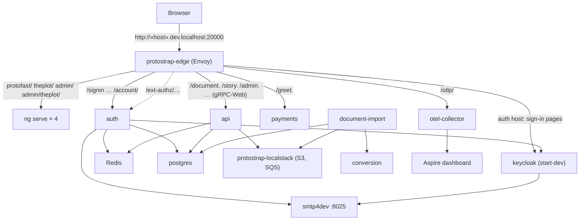
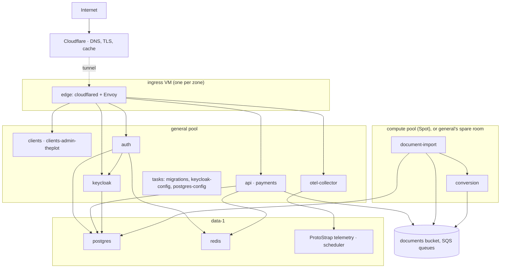

# 01 · Topology

*What runs, where it runs, and the path a request takes. Self-contained.*

## The pieces

Each row is one component of the spec, by its name there. The AppHost declares all of them
([`apphost/Program.cs`](../apphost/Program.cs)).

| Component               | Kind     | What it is                                                         | Source                                  |
| ----------------------- | -------- | ------------------------------------------------------------------ | --------------------------------------- |
| `clients`               | service  | One Node host serving the `protofast`, `theplot` and `admin` SSR apps, each on the host of its name | `clients/Dockerfile`, `clients/host` |
| `clients-admin-theplot` | service  | The same image serving only theplot's admin console, on `admin/theplot/` | `clients/Dockerfile`               |
| `auth`                  | service  | BFF: sign-in, sessions, account management, and the edge's authorizer | `services/auth`                      |
| `api`                   | service  | gRPC: documents, uploads, stories, and the admin consoles' RPCs    | `services/api`                          |
| `payments`              | service  | gRPC: the `greet` service so far                                    | `services/payments`                     |
| `conversion`            | service  | Document to Markdown (MarkItDown, CPU OCR), HTTP, no routes        | `services/conversion`                   |
| `document-import`       | worker   | Drains the `document-upload` queue through conversion and the model APIs | `services/document_import`        |
| `keycloak`              | service  | Identity provider: realms `protofast`, `theplot`, `operators`      | `services/keycloak`                     |
| `keycloak-config`       | task     | Keycloak's configure task: applies the three realms                | `services/keycloak-config`              |
| `otel-collector`        | service  | Takes browsers' traces and logs on `/otlp/` and passes them on     | `services/otel-collector`               |
| `auth-migrations`       | task     | auth's schema migrations, auth's `migrate`                         | `services/auth/src/ProtoFast.Auth.SchemaMigrations` |
| `protofast-migrations`  | task     | The `protofast` database's migrations, the api's and document-import's `migrate` | `services/api/src/ProtoFast.SchemaMigrations` |
| `postgres-config`       | task     | PostgreSQL's configure task: a user and a database per connection string | `services/postgres_config`        |
| `postgres`              | stateful | PostgreSQL 18: databases `keycloak`, `auth`, `protofast`           | upstream `postgres:18.3`                |
| `redis`                 | stateful | Sessions, sign-in correlation and replay guards; memory only       | upstream `redis:8.6`                    |

The spec also has a bucket, `documents` (browser uploads, versioned, object lock), two
queues, `document-upload` and `workflow-outcomes` (FIFO), and email from the protofast host's
domain. ProtoStrap adds its own edge and telemetry; neither is in the AppHost.

## Hosts

The spec names hosts, and components refer to a host only by its name: every replica gets
`HOST_<NAME>` and `ORIGIN_<NAME>` for each. The AppHost gives each name its prod and local
hostnames (`WithHost`), so the spec carries prod's; in the account, prod's platform root takes
them from bootstrap's `hosts` ([layer 08](08-infrastructure.md#hosts-and-mail)), which must
name the same ones.

| Name        | Prod                    | Locally                   | Serves                                                    |
| ----------- | ----------------------- | ------------------------- | --------------------------------------------------------- |
| `protofast` | `protofast.dev`         | `protofast.dev.localhost` | the protofast client, auth's sign-in paths, api, payments |
| `theplot`   | `theplot.protofast.dev` | `theplot.dev.localhost`   | the theplot client, auth's sign-in paths, api, payments   |
| `admin`     | `admin.protofast.dev`   | `admin.dev.localhost`     | the admin console, theplot's console at `/theplot/`, auth's sign-in paths, api, payments |
| `auth`      | `auth.protofast.dev`    | `auth.dev.localhost`      | Keycloak's sign-in pages only                              |

Each client has a host of its own because cookies ignore ports: two clients on one host would
share one `pf_session`.

## Locally

`aspire run` starts everything as local processes and containers. Projects and dev servers
get ports from Aspire. The fixed ports are the local edge's, 20000, smtp4dev's, 8025, and the
dashboard's own, in `apphost/Properties/launchSettings.json`.
[Layer 02](02-local-development.md) has the details.

Key facts:

- **One port for every host.** The local edge is ProtoStrap's Envoy, rendered from the same
  routes and authorizer as an account's, on plain HTTP. Browsers resolve `*.localhost` to
  loopback.
- **Keycloak is behind the edge too,** on the auth host, with the same allowlist as in an
  account. auth and keycloak-config reach it directly.
- **A resource's own URL on the dashboard reaches it directly,** past the edge's routing and
  authorizer.

## In an account

Key facts:

- **The VMs are ProtoStrap's.** An ingress VM per zone runs the edge alone, and is its zone's
  NAT: every outbound call but S3's, to the model APIs, SES or other AWS APIs, leaves through
  it. The general pool runs every service, worker and task, apart from conversion and
  document-import, which are compute's. Compute keeps no VM of its own until they outgrow the
  general VMs' spare room, so they usually start there, on On-Demand VMs, and move to Spot
  compute VMs when they don't fit. data-1 holds PostgreSQL and Redis, each with its own EBS
  volume, and ProtoStrap's telemetry and scheduler
  ([ProtoStrap's VMs](https://github.com/duncan-G/protostrap/blob/v0.1.2/docs/vms.md)).
- **Containers reach each other by component name** on ProtoStrap's overlay network:
  `http://keycloak:8080`, `http://auth:8080`, `http://conversion:8090`, `postgres:5432`,
  `redis:6379`. The connection strings in the secret use these names.
- **No inbound ports.** Cloudflare terminates TLS and sends every host through the tunnel to
  the edge, which routes by host and path ([layer 04](04-edge.md)). Traffic inside the VPC
  is plain HTTP.
- **Every component sends its telemetry to ProtoStrap's collector** on data-1
  (`http://telemetry:4318`). ProtoFast's own `otel-collector` only takes what browsers send.

### Sizes

Prod is the one deployed environment, and its spec, `protostrap.yaml`, takes the smallest
VMs, `t4g.small` and `t4g.medium`. The sizes are in
[`apphost/Program.cs`](../apphost/Program.cs).

|                           | Prod                                              |
| ------------------------- | ------------------------------------------------- |
| Ingress VM                | `t4g.small`                                       |
| General pool              | `t4g.medium`, 1–4 VMs, one spare                  |
| Compute pool              | `t4g.small`, 0–3 Spot VMs                         |
| data-1                    | `t4g.medium`                                      |
| auth, api, clients        | 2–4 replicas, so a VM's loss leaves one           |
| keycloak, payments, otel-collector, clients-admin-theplot | 1 replica: a VM's loss stops it until it starts on another |
| conversion                | 1–4 replicas                                      |
| document-import           | 0–4 replicas, from the queue                      |
| PostgreSQL request        | 1 CPU, 1 GiB                                      |
| Redis request, max memory | 250m CPU, 512 MiB; `--maxmemory 256mb`            |

PostgreSQL, Redis and ProtoStrap's telemetry (500m CPU, 1.5 GiB) fill data-1's 3 GiB after
ProtoStrap's reserve. Every VM is Graviton (arm64), and every image is built for
`linux/arm64`.

## The path of a request

**A page load** (`GET https://protofast.dev/app`).
Cloudflare → tunnel → the edge's Envoy → route `protofast/` (the clients) → the edge first
asks auth at `/ext-authz/app`, with the request's Host and cookie → auth answers 200 with
`x-user-id`, `x-tenant`, `x-roles`, `x-internal-jwt` and `x-authenticated` for a live session,
or `x-authenticated: false` → the edge adds them to the request, and a rotated `pf_session`
cookie in auth's answer to the response (`respond`) → the clients host picks the `protofast`
app by the Host → SSR renders. Without `x-user-id`, `/app` redirects to `/signin`. On
`admin/theplot/` auth may answer 302 instead, to `/signin` or `/forbidden`, and the edge
hands that to the browser ([layer 04](04-edge.md#auths-answer-to-every-request)).

**A gRPC-Web call** (`POST /document.DocumentService/...`).
Same edge and the same question to auth, on route `protofast/document.` → the edge translates
gRPC-Web to gRPC → the api. The api trusts only the internal JWT that auth's answer carried;
the edge only annotates.

**A sign-in.**
`/signin` on the client's own host goes to auth (its routes aren't authorized) → auth starts
an OIDC authorization code flow with PKCE → the browser goes to the auth host, where the edge
lets through only Keycloak's sign-in pages → Keycloak redirects back to `/signin-oidc` →
auth exchanges the code with `http://keycloak:8080` on the overlay, stores the session in
Redis and sets the `pf_session` cookie.

## Locally and in an account, at a glance

|              | Locally                                              | In an account                                        |
| ------------ | ---------------------------------------------------- | ---------------------------------------------------- |
| Orchestrator | The AppHost (`aspire run`)                           | ProtoStrap's scheduler, from the spec                |
| Edge         | `protostrap-edge`, plain HTTP on port 20000          | cloudflared and Envoy on the ingress VM, behind Cloudflare |
| Clients      | `ng serve` per client (or the clients image with `SsrHost__Dev=true`) | the clients image: `clients` and `clients-admin-theplot` |
| Keycloak     | `start-dev`, themes bind-mounted, mail to smtp4dev   | the image's `start --optimized`, mail through SES    |
| S3, SQS      | LocalStack                                           | the account's bucket and queues                      |
| Secrets      | generated by the AppHost, set as environment variables | `protofast/<environment>` in Secrets Manager       |
| Telemetry    | the Aspire dashboard                                 | ProtoStrap's telemetry on data-1, read in Grafana    |
