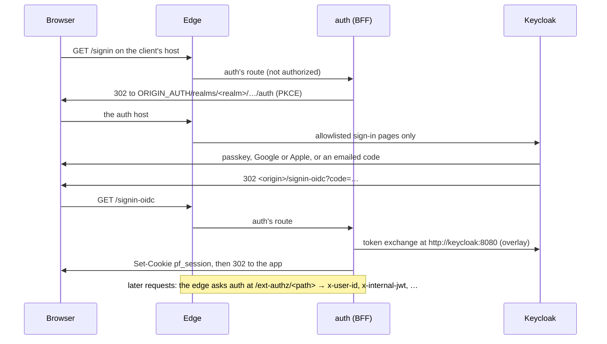

# 05 · Identity

*How sign-in is configured: Keycloak and its realms, the auth service that fronts it, and
how the two are kept in step. Self-contained.*

## The shape

auth is a **backend-for-frontend**. Browsers never hold a token: they hold an opaque
`pf_session` cookie, and auth keeps the real OIDC tokens in Redis.

On every later request to the clients, the api or payments, the edge asks auth, which resolves
the cookie and answers `x-user-id`, `x-tenant`, `x-roles`, `x-internal-jwt` and
`x-authenticated`. The edge removes any copies the browser sent first, so they can't be
smuggled in ([layer 04](04-edge.md#auths-answer-to-every-request)). The api and payments trust
only the internal JWT; SSR uses `x-user-id` for personalisation and its protected-page gate.

## The credential model

There are **no passwords in any realm**. An account is reached by passkey, by Google or
Apple, or by a code typed from an email. That single decision explains most of the realm
files: empty `passwordPolicy`, `resetPasswordAllowed: false`, `UPDATE_PASSWORD` disabled, and
a brute-force `failureFactor` of 10 tuned for guessing a six-digit code.

The mailbox therefore opens every account, including one that has a passkey. It has to, or
a passkey holder on a new laptop is locked out.

Passkeys are **offered, never required**: after a successful sign-in auth sends an ordinary
authorize request carrying `kc_action=webauthn-register-passwordless`, and cancelling costs
nothing. `/signup` carries the same offer on its own authorize request.

## Operators

The admin host signs people in to its own `operators` realm, never an app's realm.
Registration is off and there is no Google or Apple sign-in. An operator holds `platform`,
`admin-<app>` or both. Every app console lives on the admin host at `/<app>/`; auth's answer
to the edge lets only holders of its role reach it, and each admin RPC checks
`tenant=operators` plus that role again ([design](design/admin-consoles.md)).

- **Locally**, `DEV_OPERATORS` in the AppHost has keycloak-config create
  `protofast@admin.test` (`platform`, `admin-protofast`) and `theplot@admin.test`
  (`admin-theplot`), with verified addresses and no password. They sign in with the code
  smtp4dev receives.
- **In an account** there is no supported way to create an operator yet: see
  [Known gaps](#known-gaps).

## Configuring auth

Plain settings come from `appsettings.json` and the spec's `env`, which the AppHost sets
locally, and secrets from the environment's secret, `protofast/dev` locally; locally Keycloak's
client secrets are Aspire's, as keycloak-config's are ([layer 03](03-services-and-clients.md)).

| Key | Locally | In an account |
|---|---|---|
| `Keycloak:Authority` | Keycloak's own URL, from the AppHost | `http://keycloak:8080` (the spec's `env`) |
| `Keycloak:PublicAuthority` | unset, so `ORIGIN_AUTH`: `http://auth.dev.localhost:20000` | unset, so `ORIGIN_AUTH`: `https://auth.protofast.dev` in prod. Used for redirects and as the expected token issuer |
| `Keycloak:ClientSecretProtofastWeb`, `…TheplotWeb`, `…Admin` | generated, in the AppHost's user secrets | `Shared_Keycloak__ClientSecret*` |
| `Keycloak:AdminClientId`, `AdminClientSecret` | `account-admin`; generated | `account-admin`; `Shared_Keycloak__AdminClientSecret`. Empty disables account management (503) instead of failing startup. One value serves every realm's `account-admin` client |
| `Tenants:ByHost:<host>` | `appsettings.json` | the same |
| `Tenants:ByHost:admin:RequiredRoles` | `platform`, `admin-protofast`, `admin-theplot` | the same: an account holding none gets no session and lands on `/forbidden` |
| `Tenants:ByHost:admin:MaxAge` | 900 s | the same: re-authentication on entering the console |
| `Tenants:ByHost:admin:AcrValues` | empty | empty, until operator passkey coverage and a break-glass procedure are in place |
| `Tenants:ByHost:admin:Consoles` | `theplot` → `admin-theplot` | the same |
| `Session:*` | defaults | defaults: `pf_session`, 8 h idle, 7 d absolute, id rotated on refresh |
| `InternalJwt:PrivateKeyPem`, `KeyId` | a fresh pair each run, key id `local` | `Auth_InternalJwt__PrivateKeyPem`, `Auth_InternalJwt__KeyId` |
| `ConnectionStrings:auth`, `ConnectionStrings:redis` | Aspire references | `Shared_ConnectionStrings__auth`, `Shared_ConnectionStrings__redis` |
| Mail | `Smtp:Host`/`Port` to smtp4dev, `StartTls=false`, From `no-reply@protofast.dev` (`appsettings.Development.json`) | SES, with auth's role; From `Smtp:From` if set, else `no-reply@<HOST_PROTOFAST>` |
| `Subscriptions:Enabled` | off | off until billing exists |

**Tenants are keyed by the spec's host names**, `protofast`, `theplot` and `admin`, so the
same `appsettings.json` serves every environment:

| Host name   | Realm       | Client          |
| ----------- | ----------- | --------------- |
| `protofast` | `protofast` | `protofast-web` |
| `theplot`   | `theplot`   | `theplot-web`   |
| `admin`     | `operators` | `admin`         |

`TenantResolver` turns each key into that account's hostname with `HOST_<NAME>`; a key that
names no host is taken as a hostname itself. A Host that is in no entry is never guessed: it
gets no realm, and `/signin` there answers 404. (A `host:port` key is written `host+port`,
since a colon in a configuration key is a path separator, but no environment uses one.)

**Why two Keycloak authorities?** Tokens are stamped with the issuer the browser's login
used. If the back channel saw a different URL, the refresh grant would fail with "Invalid
token issuer" and every session would die at its first refresh. So Keycloak's `KC_HOSTNAME`
is `ORIGIN_AUTH` (its entrypoint sets it) with `KC_HOSTNAME_BACKCHANNEL_DYNAMIC=false`, and
auth's `PublicAuthority` defaults to the same `ORIGIN_AUTH`: back-channel calls to
`http://keycloak:8080` get the public issuer too.

## Configuring Keycloak

Keycloak is configured by three things.

### 1. The image

[`services/keycloak`](../services/keycloak) builds Keycloak 26.7 with what it reads when it
starts or builds (its [README](../services/keycloak/README.md) has every option and the upgrade
steps):

- **The providers**, built by Maven in the image build, which runs the SES sender's tests
  (the email-otp JAR has none):
  `protofast-keycloak.jar` (from `providers/email-otp`) supplies the `email-otp` authenticator,
  the `verify-email-code` required action, the claiming user-creation form action
  (`protofast-registration-user-creation`) and the Apple identity provider (`apple`);
  `ses-email-sender.jar` supplies the `ses` email sender. **The browser flow names `email-otp`
  and the registration flow `protofast-registration-user-creation` by id, so without the first
  JAR Keycloak can run neither sign-in nor sign-up.**
- **The themes**, `themes/protofast` and `themes/theplot` (login and email); each realm's
  `loginTheme` and `emailTheme` names one.
- **Build-time options**, fixed by `kc.sh build` so `start --optimized` starts at once:
  PostgreSQL, health checks, tracing and OpenTelemetry log export, and the SES email sender.
- **Run-time defaults**: plain HTTP on 8080 behind the edge, `KC_PROXY_HEADERS=xforwarded`,
  `KC_HOSTNAME_BACKCHANNEL_DYNAMIC=false`, theme files cached 5 minutes, health on the
  management port 9000 (`/health/ready`, the spec's `ready`), and a 10 s shutdown delay for
  ProtoStrap's drain.

### 2. Its entrypoint and variables

The image's entrypoint turns what ProtoStrap and the AppHost give the container into
Keycloak's own variables, without ever printing a value:

| From                                                   | Becomes                                                         |
| ------------------------------------------------------ | --------------------------------------------------------------- |
| each file in `/run/secrets` (in an account: `ConnectionStrings__keycloak`, `KC_BOOTSTRAP_ADMIN_CLIENT_SECRET`) | the variable of its name, unless already set |
| `ConnectionStrings__keycloak`, ADO.NET form (`Host=postgres;Port=5432;Database=keycloak;Username=keycloak;Password=…`) | `KC_DB_URL_HOST`, `KC_DB_URL_PORT`, `KC_DB_URL_DATABASE`, `KC_DB_USERNAME`, `KC_DB_PASSWORD` |
| `ORIGIN_AUTH`                                          | `KC_HOSTNAME`                                                   |
| `OTEL_EXPORTER_OTLP_ENDPOINT`, `_PROTOCOL`, `_HEADERS`, `OTEL_SERVICE_NAME`, `OTEL_RESOURCE_ATTRIBUTES` | Keycloak's tracing and log export settings; under ProtoStrap the console log is turned off, so each line leaves once. Without an endpoint nothing is exported |

The spec adds `KC_BOOTSTRAP_ADMIN_CLIENT_ID=protofast-admin`: Keycloak creates that
service-account client in `master` on its first start, with the secret
`Keycloak_KC_BOOTSTRAP_ADMIN_CLIENT_SECRET`, and keycloak-config logs in with it. Keycloak
sends mail with SES using its component's role (`uses: [email]`).

Locally the AppHost runs `start-dev` instead, which builds as it starts: it switches the
email sender back to SMTP (`KC_SPI_EMAIL_SENDER__PROVIDER=default`), bind-mounts the themes,
and adds a bootstrap admin user, `admin`, for keycloak-config to log in as.

### 3. The realms: keycloak-config

The realms aren't imported at startup. [`services/keycloak-config`](../services/keycloak-config)
is keycloak's configure task: ProtoStrap runs it once Keycloak is ready, and again whenever
the task's image, one of its keys, Keycloak's release or a hostname changes
([configure tasks](https://github.com/duncan-G/protostrap/blob/v0.1.5/docs/config.md#configure-tasks)).
It runs keycloak-config-cli, which makes `protofast`, `theplot` and `operators` match
`realms/*.json` through Keycloak's admin API, creating a realm that's missing, and exits 0
only when all of it is applied. Locally it runs once each `aspire run`, after Keycloak is
healthy, and auth waits for it.

The realm files substitute `$(env:NAME)` from the task's environment:

| Variable | Supplies |
|---|---|
| `Keycloak__ClientSecretProtofastWeb`, `…TheplotWeb`, `…Admin` | the web clients' secrets |
| `Keycloak__AdminClientSecret` | every realm's `account-admin` client |
| `ORIGIN_PROTOFAST`, `ORIGIN_THEPLOT`, `ORIGIN_ADMIN` | each client's home URL, redirect URI (`<origin>/signin-oidc`), web origin and post-logout redirects |
| `AUTH_URL` | where Keycloak posts logout tokens, `<AUTH_URL>/backchannel-logout`: `http://auth:8080` on the overlay |
| `WEBAUTHN_RP_ID`, `THEPLOT_WEBAUTHN_RP_ID`, `OPERATORS_WEBAUTHN_RP_ID` | worked out from `HOST_PROTOFAST` and `HOST_AUTH`: protofast's is `HOST_PROTOFAST` when `HOST_AUTH` is under it (`protofast.dev` in prod), else `HOST_AUTH`; theplot's and operators' are `HOST_AUTH`. One per realm, so a realm's passkeys never show in another's picker; each must be Keycloak's host or a parent of it |
| `SMTP_HOST`, `SMTP_PORT`, `SMTP_FROM`, `SMTP_USER`, `SMTP_PASSWORD`, `SMTP_AUTH`, `SMTP_STARTTLS`, `SMTP_SSL` | the realm's mail settings. Locally the AppHost points host and port at smtp4dev; in an account the SES sender ignores the server and uses `from` (default `no-reply@<HOST_PROTOFAST>`) and the display name |
| `GOOGLE_CLIENT_ID`, `GOOGLE_CLIENT_SECRET`, `APPLE_CLIENT_ID`, `APPLE_TEAM_ID`, `APPLE_KEY_ID`, `APPLE_PRIVATE_KEY` | social sign-in for protofast and theplot; empty by default, and both providers ship **disabled** |
| `DEV_OPERATORS` | locally only: operators-realm users and their roles |

In an account it logs in with the bootstrap admin client's client-credentials grant on
`master`; locally with `admin`'s password (`KEYCLOAK_GRANTTYPE=password`), since a local
database made before the bootstrap client existed has only that user. It reads its secrets as
files, under keycloak's own prefix (`secret_prefix: Keycloak_`) plus the `Shared_` client
secrets.

### The realm clients

| Client | Realms | Kind | Used for |
|---|---|---|---|
| `protofast-web` | `protofast` | confidential | the product site's OIDC flow |
| `theplot-web` | `theplot` | confidential | ThePlot's OIDC flow |
| `admin` | `operators` | confidential | the admin console's OIDC flow (with `max_age`, optional `acr_values`) |
| `account-admin` | all three | confidential, service account only | the Admin API calls a user makes about their own account: list or remove passkeys, change email, delete account. Holds `view-users` and `manage-users` and nothing else; no sign-in path touches it |

### The flows

`passwordless browser` is each realm's browser flow: Cookie → Identity Provider Redirector →
forms, where the forms branch is a level-1 conditional (username → WebAuthn **or** email
code, both alternatives) plus a level-2 step-up conditional that demands a passkey.
`acr.loa.map` maps `basic` → 1 and `passkey` → 2; only the admin client may ask for
`passkey`, and auth verifies the `acr` that comes back, because asking is not getting.

Registration is `passwordless registration`, whose form action is
`protofast-registration-user-creation`: it lets someone finish a sign-up they abandoned before
verifying their address, instead of being told "email already registered" forever.

The full rationale, including which "tidy-ups" silently break the flows, is in
[keycloak-config's README](../services/keycloak-config/README.md#the-browser-flow).

## Changing the realms

Edit `services/keycloak-config/realms/*.json` and ship it: the task's image holds the files,
so a release that changes them runs it. keycloak-config applies **every realm, every run**
(its checksum cache is off), so a run after a failure, a rollback or a Keycloak upgrade puts
everything back.

| Change | How it lands |
|---|---|
| Realm settings, clients, roles, required actions, components, flows, identity providers | the next run applies them, flows included |
| Something removed from the files | deleted if keycloak-config applied it before (it keeps that list in each realm's attributes). A top-level flow or identity provider that isn't built in and isn't in the files is deleted unless something uses it, so add those in the files, never in the console |
| Client scopes and scope mappings | added and changed, never deleted |
| Users | never deleted. Users the files list (each realm's `account-admin` service account, and `DEV_OPERATORS` locally) get exactly the roles listed |
| A client secret | write it in the secret. keycloak-config runs again and sets it before auth is replaced with it |
| A hostname | ProtoStrap runs every configure task again, so redirect URIs follow |
| Locally | restart the AppHost: keycloak-config's image is rebuilt and it applies the files to the existing realms. No database drop |

Whatever someone changes in Keycloak's admin console, in a kind the files manage, is put back
on the next run. A run that changes nothing leaves everything as it is, ids included.

**A flow change briefly breaks sign-in.** keycloak-config-cli changes a flow by binding a
temporary one, recreating the flow with all its sub-flows, and binding it again; while that
runs, about a second, sign-in fails, and a run that fails in the middle can leave the temporary
flow bound until the next run or the rollback's. Change a flow when that doesn't matter, and
watch the run.

## Mail

| | Locally | In an account |
|---|---|---|
| auth | SMTP to smtp4dev | SES v2 API, with auth's role |
| Keycloak | its built-in SMTP sender, to smtp4dev | the image's `ses` email sender, with keycloak's role |
| From | `no-reply@protofast.dev` (auth), `no-reply@protofast.dev.localhost` (realms) | `no-reply@<HOST_PROTOFAST>`: `no-reply@protofast.dev` in prod |

ProtoStrap creates an SES identity, DKIM and a MAIL FROM domain for each of the account's
`email_domains` ([email](https://github.com/duncan-G/protostrap/blob/v0.1.5/docs/email.md)).
Only components with `email` in their `uses`, auth and keycloak, may send, and only from those
domains.

## Known gaps

- **Unverified in an account.** Nothing has run on AWS yet: SES sending, the client-credentials
  login, and the issuer behind Cloudflare are all untested there.
- **Operators in an account.** keycloak-config's README names
  `scripts/keycloak-grant-admin.py` for this, but the script needs Keycloak's admin API, which
  the edge doesn't route and only the overlay reaches. `DEV_OPERATORS` is local only. How an Org
  Admin makes the first operator in an account is still to be decided.
- **Google and Apple.** Nothing passes `GOOGLE_*` or `APPLE_*` to keycloak-config, so the realm
  files substitute empty values and the providers stay disabled. Enabling one takes its keys
  passed to keycloak-config in the AppHost, which makes them its secret files, and set as
  `Keycloak_GOOGLE_*`/`Keycloak_APPLE_*` in the secret.
- **Keycloak's readiness doesn't test the Host.** `9000/health/ready` is Keycloak's own and
  can't be told to answer only for `keycloak`, as ProtoStrap's contract asks.
- **SES sandbox.** A new account's SES sends only to verified addresses, 200 a day, until an
  Org Admin asks AWS for production access, once per account. The prod root doesn't set
  `email_dmarc`, so no DMARC record is published.
