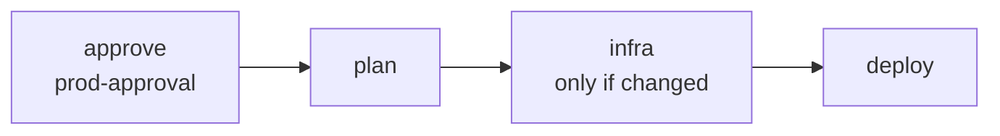

# 07 · Deployment

*How a commit reaches prod, what rolls it out, and how to roll back. Self-contained.*

## The model: a release is the whole application at one commit

ProtoFast deploys with ProtoStrap's reusable workflows. Each deploy writes a **release**: the
spec and every component's image tag at one commit. ProtoStrap's scheduler, on data-1, rolls
the account to it.

Every built image is tagged from its own sources, so identical sources give an identical tag,
the build is skipped, and the component's replicas aren't touched. Mixed ages across
components are normal. Rolling back is deploying an earlier commit's release: its images are
still in ECR.

| Component                                     | Image                                     | Tagged from                                             |
| --------------------------------------------- | ----------------------------------------- | ------------------------------------------------------- |
| auth, api, payments, document-import, auth-migrations, protofast-migrations, postgres-config | the .NET SDK's container publish of the `project`, with the SDK `global.json` pins, on the base image `Directory.Build.targets` pins (ASP.NET's chiseled runtime) | the project's directory, `global.json` and the spec's `sources`: the projects it references, `Directory.Build.targets`, `nuget.config` |
| clients, clients-admin-theplot                | `clients/Dockerfile` (one image)          | `clients/`, minus what `.dockerignore` leaves out       |
| conversion, keycloak, keycloak-config, otel-collector | their own `Dockerfile`            | their directory, minus the files the image doesn't use (the exclusions in the spec's `sources`: README, tests, build output) |
| postgres, redis                               | upstream `postgres:18.3`, `redis:8.6`, copied into ECR | the tag itself                               |

Every image is built for `linux/arm64` (Graviton). Base images are pinned by their
multi-platform index digest; a patched base image is a commit.

## The pipeline

**[`ci.yml`](../.github/workflows/ci.yml)** runs on every pull request and every push to
`main`, with no AWS access. main's ruleset should require each of its jobs' checks (GitHub
has no single `ci` check), since the deploy runs no tests:

| Job            | Checks                                                                          |
| -------------- | ------------------------------------------------------------------------------- |
| `dotnet`       | `dotnet test ProtoFast.slnx` (integration tests start PostgreSQL and LocalStack in Docker); the spec is what the AppHost writes; `protostrap check` on it |
| `clients`      | per client: `npm ci`, the generated gRPC code matches the protos, `npm test`, `ng build`; the admin consoles' isolation checks (`scripts/check-admin-console.py`) |
| `clients-host` | `node --test` in `clients/host`                                                  |
| `conversion`   | `python -m pytest`                                                              |
| `images`       | each Dockerfile builds (amd64 here); Keycloak's and keycloak-config's entrypoint tests; Keycloak's build runs its providers' Maven tests |
| `terraform`    | `terraform fmt -check` and `validate` on every root, without a backend          |

CI checks ProtoStrap out at `v0.1.6` into `.protostrap`, where the AppHost finds
ProtoStrap.Hosting and the `protostrap` action builds the CLI.

**[`deploy.yml`](../.github/workflows/deploy.yml)** runs on every push to `main` (and by hand),
after CI passed on the pull request, and deploys to prod. One run at a time
(`concurrency: deploy`): the running one is never cancelled, and of those waiting behind it
GitHub keeps only the newest, which carries the skipped commits too:



| Job       | ProtoStrap workflow | Does                                                              |
| --------- | ------------------- | ----------------------------------------------------------------- |
| `approve` | (none)              | waits in the `prod-approval` GitHub environment: one approval per release, and a second, in `prod-infra`, when the infrastructure changed |
| `plan`    | `plan.yml`          | regenerates `protostrap.yaml` from the AppHost, fails if it differs from the commit, checks it, and works out which image tags are missing and whether the infrastructure changed |
| `infra`   | `infra.yml`         | only when the plan says the infrastructure changed: puts the `protostrap` binary of the spec's version in the deploy bucket, so every new VM boots with its agent, then applies `infra/prod` |
| `deploy`  | `deploy.yml`        | builds and pushes the missing images, copies ProtoStrap's binary, edge and telemetry images and the upstream images, writes the release, and sends `protostrap-deploy` to prod's data-1 through SSM |

The reusable workflows sign in to AWS with GitHub's OIDC token, as the Deploy role in the
`prod` GitHub environment and the Infra role in `prod-infra`.

**[`infra.yml`](../.github/workflows/infra.yml)** plans, applies or destroys prod's platform by
hand, and applies it when its root (`infra/prod/**`) changes on `main`
([layer 08](08-infrastructure.md)).

## Rolling out in the account

The scheduler rolls out every changed component together, a quarter of its replicas at a
time: start new ones, wait until they're ready, stop as many old ones
([deploy a release](https://github.com/duncan-G/protostrap/blob/v0.1.6/docs/protostrap.md#deploy-a-release)).
For ProtoFast that means:

- **Migrations run first, as tasks.** `auth-migrations` is auth's `migrate`, and
  `protofast-migrations` is both the api's and document-import's, run once. A task runs in a
  release in which its tag is new, before the first new replica of what waits for it, and the
  rollout carries on only if it exits 0. Migrations must stay compatible with the previous
  release, which keeps running during the rollout and after a rollback.
- **Configure tasks run after.** `postgres-config` runs once PostgreSQL is ready and makes each
  database's user and database from the connection strings; `keycloak-config` runs once
  Keycloak is ready and applies the realms. Each runs again when its image, its keys or its
  component changes, and what depends on the component waits for it.
- **`depends_on` orders the first deploy** into an empty environment: postgres and redis, then
  postgres-config, keycloak, keycloak-config, then auth and the api.
- **Stateful components stop before they start,** so a new PostgreSQL or Redis image is a brief
  outage.
- **A failure rolls back the whole release.** If a task fails, or a new replica isn't ready
  within 5 minutes, the scheduler returns to the last good release, applies its configure
  tasks again, and the workflow's job fails with the reason.
- **A newer release wins.** One that arrives mid-rollout becomes the target.

Secrets aren't part of a release: ProtoStrap applies a new value when it is written
([layer 06](06-secrets.md#changing-a-value)). Set an environment's secret before its first
deploy, since components with secret files fail without their keys.

## Rolling back

A release that rolled out but is wrong is replaced by deploying an earlier commit
([rolling back](https://github.com/duncan-G/protostrap/blob/v0.1.6/docs/production.md#rolling-back)):

- **`git revert`** the change and merge. It goes through approval like any release.
- **Faster:** re-run the deploy workflow's run for the last good commit. Its images are still
  in ECR, so nothing is built; prod still waits for approval.

  ```bash
  gh run list --workflow deploy.yml --commit <last good commit>
  gh run rerun <run id>
  ```

Migrations aren't undone, and a secret is never rolled back: write the right value.

## Everyday operations

| I want to…                         | Do this                                                                 |
| ---------------------------------- | ----------------------------------------------------------------------- |
| Ship a change                      | merge to `main`; prod deploys once approved                             |
| Roll back                          | revert, or re-run the last good commit's deploy run                     |
| Change a component's settings, routes or size | edit the AppHost, write the spec, merge                  |
| Change a secret                    | `scripts/set-secrets.sh prod --rotate <group>` or ProtoStrap's `set-secret.sh`; no deploy |
| See what is running, or why a deploy failed | the workflow's log (`gh run view <id> --log-failed`), `protostrap status`, the operator UI (`scripts/operator-ui.sh`) and Grafana (`scripts/telemetry.sh`) through SSM ([ProtoStrap's protostrap-operate skill](https://github.com/duncan-G/protostrap/blob/v0.1.6/plugins/protostrap/skills/protostrap-operate/SKILL.md)) |
| Upgrade Keycloak                   | the base image's digest in `services/keycloak/Dockerfile`, and each provider's `keycloak.version` to match; check keycloak-config's client library knows the new realm fields |
| Upgrade PostgreSQL or Redis        | their tags come from Aspire's PostgreSQL and Redis integrations (13.6.2); `WithImageTag` in the AppHost pins another. Nothing here upgrades PostgreSQL's data across a major version |
| Upgrade ProtoStrap                 | in one pull request: `WithVersion` in the AppHost (then the spec), every workflow's `@v…` and `protostrap-ref`, `ci.yml`'s checkout, every root's `?ref=`, and `.claude/settings.json`'s `ref` |

## GitHub settings

`infra/bootstrap` creates the `prod` and `prod-infra` environments and their variables. The
rest is by hand, per ProtoStrap's
[production checklist](https://github.com/duncan-G/protostrap/blob/v0.1.6/docs/production.md):

| Setting                                         | Why                                                         |
| ----------------------------------------------- | ----------------------------------------------------------- |
| `CLOUDFLARE_API_TOKEN` in `prod-infra`          | the infra workflow's Cloudflare access                      |
| `prod-approval`, with required reviewers        | the approval every release in `deploy.yml` waits for        |
| Required reviewers on `prod-infra`              | otherwise `infra.yml` applies a change to `infra/prod` on push to `main` with no approval; a release that changes the infrastructure waits here too |
| Deployment branches `main` only, on `prod` and `prod-infra` | the AWS roles trust these environments, so this decides what code can take them on |
| A ruleset on `main` requiring review and each `ci.yml` job's check (`dotnet`, `clients (…)`, `clients-host`, `conversion`, `images (…)`, `terraform`) | the deploy runs no tests |

Bootstrap doesn't manage the reviewers or the branch limits, and applying it again can clear
them on `prod` and `prod-infra`: check them after.

## Known gaps

- **Nothing has deployed yet.** The pipeline, the first deploy into an empty account and the
  rollback path are unverified until prod's first release, which goes out before prod serves
  anyone, so these checks run there.
