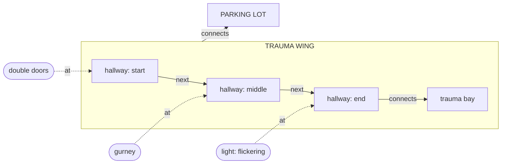

# Location world model

*How to model what a location contains, how it changes, how it relates to other
locations, and which part of it each beat happens in, learned from the beats of
the story.*

> **Status (2026-10-11).** Built on the document-import pattern: a queue, a consumer and a
> ledger.
>
> - tables of §9 in the `plot` schema (migration `LocationWorldModel`), plus the ledger:
>   `world_model_builds` (one per request: status, scenes done, cost, counts) and
>   `world_model_build_steps` (seed, one row per scene read with the prompt sent, the reply,
>   tokens and cost, finish);
> - the writer's **World** button in the scene editor header (`WorldModels` RPCs: start, latest,
>   cancel) queues a build on the SQS queue `protofast-world-model-build`;
> - the document-import worker drains it (`WorldModelBuildConsumer` → `WorldModelBuildRunner`):
>   scenes in one location in story order, locations side by side; a redelivery resumes at the
>   first scene not read. The fold of §5 and the rules of §4 and §7 are code in
>   `ProtoFast.Data/ThePlot/WorldModel`, shared by the worker and the api;
> - theplot's console lists every build and its steps at `/world-models` (`TheplotWorldModels`),
>   and shows a story's world at `/stories/:id/world` (`GetWorld`): a timeline of scenes and
>   beats, the place at the playhead with what each beat changed, a map of every place, the
>   cast, the conflicts, and each node's history.
>
> Author corrections (§7) have rows reserved (`Author` origins) but no UI yet; the push-back of
> fixtures (§4) always applies, since nothing records that a beat put a fixture in place.

## 1. What we know and what we don't

- **Known:** every location's name, the location of each scene, and the order of
  scenes and beats.
- **Unknown:**
  - what's in each location;
  - how it changes over time;
  - how it relates to other locations;
  - which part of it a beat happens in.

The model is a **temporal knowledge graph**:

- Places and objects are **nodes**.
- Relationships are **edges**.
- Each edge holds over a stretch of story time and is backed by the beats that
  say so.

## 2. Nodes

| Node         | Comes from      | Examples                                   |
| ------------ | --------------- | ------------------------------------------ |
| **Location** | The heading (known) | TRAUMA WING, PARKING LOT               |
| **Part**     | Beats           | start of the hallway, trauma bay           |
| **Object**   | Beats           | double doors, gurney, blood on the floor   |
| **Character** | The story (known) | BRYAN                                  |

A **place** is a Location or a Part of one.

An Object's kind decides whether it lasts beyond its scene:

| Kind       | Examples                      | Lasts until               |
| ---------- | ----------------------------- | ------------------------- |
| Fixture    | doors, windows, a bar counter | a beat changes it         |
| Prop       | gurney, cooler                | a beat moves or removes it |
| Dressing   | blood, smoke, broken glass    | a beat cleans or ends it  |
| Occupant   | nurses, a crowd               | the end of the scene      |

## 3. Edges

| Edge           | From → To            | Changes over time? |
| -------------- | -------------------- | ------------------ |
| `part_of`      | Part → place         | No                 |
| `next`         | Part → Part          | No. Orders the parts of a linear space: hallway start → middle → end |
| `inside`       | Location → Location  | No                 |
| `connects`     | place ↔ place, optionally through an Object (a door) | Yes |
| `at`           | Object → place       | Yes                |
| `state`        | Object → value (`lit = flickering`) | Yes  |
| `character_at` | Character → place    | Yes                |
| `beat_at`      | Beat → place         | Yes                |

## 4. Time

Story time is a position in the story: scene order, then beat order. Each fact
starting at a beat holds until a later fact on the same subject and edge
replaces it. If nothing replaces it, it carries forward, across scenes too.
Occupants are the exception, because their facts end with their scene.

Fixtures and Parts reach back as well: one first mentioned late was there from
the first scene set in its place, unless a beat says it was put there.

Unknown is not false. An Object is gone only when a beat says it left or was
removed.

## 5. Evidence and facts

Each beat gives **observations**, small claims taken from its text:

> *She shoves through the double doors. A gurney blocks half the hallway; the
> light at the far end flickers.*

| Observation                                   | Stated or implied |
| --------------------------------------------- | ----------------- |
| double doors `at` hallway start               | stated            |
| gurney `at` hallway middle                    | stated            |
| light `at` hallway end, `lit = flickering`    | stated            |
| start `next` middle `next` end                | implied           |
| this beat `at` hallway start                  | implied           |

Building facts from observations takes three steps:

1. **Match names.** "the doors", "the double doors" and "the swing doors" are
   the same Object. "the far end" is the hallway's end Part.
2. **Order** each subject's observations for an edge by story time.
3. **Walk** them. Each observation does one of three things:
   - It **confirms** the current fact.
   - It **changes** the fact. The old fact ends at this beat and a new one starts.
   - It **conflicts** with the fact: it disagrees, and no beat in between explains
     the change. An author's statement wins. Otherwise the stated observation
     beats the implied one.

Facts are always rebuilt from observations, so editing a beat takes back what it
caused.

## 6. Where a beat happens

- The heading gives the Location.
- The Part is a `beat_at` fact. It carries forward like any other fact.
- When two characters are in different parts, `character_at` records each one.

A scene that walks down the hallway reads as beats 1–3 at the start, 4–7 in the
middle and 8 at the end, without tagging every beat.

## 7. Building the graph

The story is read once, in order, one scene at a time.

- **A language model reads the text.** It finds entities, links them to nodes
  or adds new ones, and returns the edges each beat gives.
- **Code applies the rules:** time, carrying forward, ending occupants,
  connections between scenes and pushing back.
- **The author corrects anything.** A correction wins over everything else.

### Seed

- Add one Location per heading name and one node per character.
- When a heading nests names (HOSPITAL – TRAUMA WING), add `inside`.

### Read each scene (model)

Each scene gets its own context window, containing:

- every Location name and every character. That is how the model tells a Part
  ("the lobby") from a Location, and how it can link to places no scene has
  reached yet;
- the scene's beats, each labelled with its id;
- the graph of the scene's location as the scene opens: Parts, Objects with
  aliases and states, and connections;
- where each character was last seen.

For every beat, the model does three things.

1. **Finds entities:** places and positions, objects and characters.
2. **Links each entity to an existing node, or adds one:**
   - An unknown position becomes a new Part under the current place, named or
     unnamed ("a room off the hallway").
   - An unknown object becomes a new Object, with a kind chosen from how the text
     uses it.
   - A new name for a known Object becomes one of its aliases.
   - A place name never creates a Location.
   - When unsure, it links rather than adds.
3. **Returns edges.** Each edge carries its beat id and whether it is stated or
   implied:

| The text…                                              | Edge           |
| ------------------------------------------------------ | -------------- |
| puts an object somewhere ("a gurney blocks the hallway") | `at`         |
| describes an object ("the light flickers")             | `state`        |
| shows a way to get directly from one place to another ("the doors to the trauma bay") | `connects` |
| orders positions ("halfway down", "the far end")       | `next`         |
| puts one place within another (a trauma wing reached from a hospital lobby) | `inside` |
| moves a character ("she walks to the end")             | `character_at` |
| happens at a position                                  | `beat_at`      |

Seeing a place is not a way to it, so "through the window, the lot" gives no
`connects`.

### Apply (code)

Each edge goes through the walk in section 5: it confirms, changes or conflicts
with the current fact.

### Close the scene (code)

- End every Occupant's edges.
- If a character leaves through a way out and the next scene picks them up
  somewhere else, add `connects` between the two places, through that way out.

### Order

- Scenes in the same location run in story order, because each one starts from
  the graph the last one left.
- Scenes in different locations run in parallel.

### Finish the story (code)

Push Fixtures and Parts back to the first scene set in their place. Props,
Dressing, Occupants and characters are not pushed back.

### After an edit

Read only the edited scene again, replace its observations, and rebuild the
facts.

## 8. Example

| Beat       | Text                                           | Facts after it                                       |
| ---------- | ---------------------------------------------- | ---------------------------------------------------- |
| S2 heading | INT. TRAUMA WING – NIGHT                       | scene at TRAUMA WING                                 |
| S2 b1      | Bryan shoves through the double doors.         | doors `at` start; Bryan `at` start; beat `at` start  |
| S2 b3      | A gurney blocks half the hallway.              | gurney `at` middle; beat `at` middle                 |
| S2 b6      | At the far end, a light flickers over the trauma bay doors. | light `at` end, flickering; end `connects` trauma bay; beat `at` end |
| S5 heading | INT. TRAUMA WING – DAY                         | doors, gurney and flickering light carry forward     |
| S5 b2      | An orderly wheels the gurney away.             | gurney no longer `at` middle                         |
| S5 b4      | The light is steady now.                       | light `lit = steady`                                 |

At S5 b1 the hallway's end has the light, still flickering, and the doors to the
trauma bay. At S5 b3 nothing is known in the middle of the hallway.

## 9. Data model (Postgres)

The graph lives in ordinary tables next to the existing ones (`locations`,
`characters`, `props`, `scenes`, `scene_elements`).

- **Nodes are rows.**
- **Timeless edges are columns.**
- **Edges that change over time are rows in one observations table, each tied to
  its beat.**

Facts are not stored. Code folds them from the observations (section 5).

| Graph                          | Stored as                                         |
| ------------------------------ | ------------------------------------------------- |
| Location, Character            | existing `locations`, `characters`                |
| Part                           | `location_parts`                                  |
| Object                         | `location_objects`                                |
| `part_of`                      | `location_parts.location_id` + `parent_part_id`   |
| `next`                         | `location_parts.position`                         |
| `inside`                       | `locations.inside_location_id`                    |
| `at`, `state`, `connects`, `character_at`, `beat_at` | `location_observations` rows |

A place is written as two columns: `…_location_id` (required) and `…_part_id`
(null for the whole location).

### `locations` (new column)

| Column             | Type  | Notes                               |
| ------------------ | ----- | ----------------------------------- |
| inside_location_id | uuid? | `inside`. Set null when that location is deleted |

### `location_parts`

Owned by its Location, so it has no `user_id`. Deleting the location deletes its
parts.

| Column         | Type   | Notes                                                   |
| -------------- | ------ | ------------------------------------------------------- |
| id             | uuid   |                                                         |
| location_id    | uuid   |                                                         |
| parent_part_id | uuid?  | `part_of` another part. Null when directly under the location |
| name           | text?  | Null for an unnamed part ("a room off the hallway")     |
| description    | text?  |                                                         |
| position       | int?   | `next`: order among sibling parts of a linear space     |
| origin         | enum   | `Extracted`, `Author`                                   |

### `location_objects`

Top level, because it is listed on its own (a location's contents, an object's
history), so it carries `user_id`.

| Column      | Type   | Notes                                             |
| ----------- | ------ | ------------------------------------------------- |
| id          | uuid   |                                                   |
| user_id     | text   |                                                   |
| story_id    | uuid   |                                                   |
| name        | text   | Canonical name                                    |
| aliases     | text[] | Other names the beats use ("the doors")           |
| kind        | enum   | `Fixture`, `Prop`, `Dressing`, `Occupant`         |
| prop_id     | uuid?  | Set when it is a story Prop. Set null on delete   |
| description | text?  |                                                   |

### `location_observations`

Owned by its beat (`scene_elements`), so it has no `user_id`. Deleting or
re-reading a beat replaces its rows.

| Column             | Type   | Used by                                      |
| ------------------ | ------ | -------------------------------------------- |
| id                 | uuid   |                                              |
| scene_element_id   | uuid   | all: the beat it came from                   |
| edge               | enum   | `At`, `State`, `Connects`, `CharacterAt`, `BeatAt` |
| object_id          | uuid?  | `At`, `State`                                |
| character_id       | uuid?  | `CharacterAt`                                |
| place_location_id  | uuid?  | `At`, `CharacterAt`, `BeatAt`, one end of `Connects` |
| place_part_id      | uuid?  | as above                                     |
| other_location_id  | uuid?  | the other end of `Connects`                  |
| other_part_id      | uuid?  | as above                                     |
| via_object_id      | uuid?  | `Connects`: the way through                  |
| property           | text?  | `State` ("lit")                              |
| value              | text?  | `State` ("flickering"); `Connects`: `closed` ends the connection |
| basis              | enum   | `Stated`, `Implied`                          |
| origin             | enum   | `Extracted`, `Rule` (cross-scene `connects`), `Author` |

An `At` row with no place means the object left or was removed.

Check constraints, one per edge, set exactly the columns that edge uses:

| Edge          | Required                                             | Null                       |
| ------------- | ---------------------------------------------------- | -------------------------- |
| `At`          | object_id (place optional)                           | character, other place, via, property, value |
| `State`       | object_id, property, value                           | places, character, via     |
| `Connects`    | place_location_id, other_location_id                 | object, character, property |
| `CharacterAt` | character_id, place_location_id                      | object, other place, via, property, value |
| `BeatAt`      | place_location_id                                    | object, character, other place, via, property, value |

Indexes: `scene_element_id`, `object_id`, `character_id`, `place_location_id`.

### Reading the graph

One query loads a story's observations joined to their beats' positions,
ordered by container, scene and beat position. The fold runs over that list.
Reordering scenes or beats changes only the positions, never the observations.
